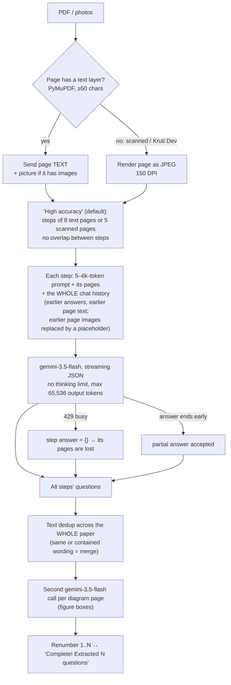
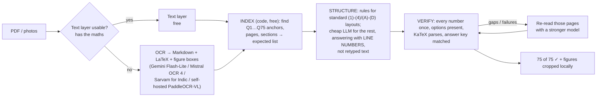

# AI import: why questions go missing, and how to make it much cheaper

*31 Oct 2026. Analysis only: no code, settings or data were changed.*

Covers **Generate with AI → Extract** (`/ai/parse-stream`), the feature behind the feedback *"Doesn't recognized all questions in the PDF"* and your JEE Main runs that came out at 73–74 of 75.

---

## 1. Summary

### Missing questions

In every case I could trace, Gemini did read the paper. The questions were lost afterwards: by our own code, or by Google errors our code ignores. Nothing counts the questions, so the screen says *"Complete!"* whether it found 75 or 68.

| # | Cause | Proof (your own runs and live logs) | Questions lost |
|---|---|---|---|
| 1 | **A text "duplicate remover" runs over the whole paper** and merges different questions that have the same wording | JEE Main 2025, *7 Apr Shift-2*: Chemistry **Q37 and Q38** ("Match List-I with List-II…") were merged into Q32, giving 73/75. The surviving question has **Q32's picture with Q38's options**, so the test is also wrong. | 1–3 per paper with repeated wording |
| 2 | **Google says "busy" (error 429) and the whole step (5–8 pages) is thrown away**, with no retry | Live logs, 24–31 Oct: **13 of 92** "High accuracy" uploads lost at least one step; **63 steps** lost in total | 5–25 per lost step |
| 3 | **A step's answer stops early and its last pages are silently dropped** | JEE Main 2026, *21 Jan Shift-1*: one run lost **Q54–Q60** (pages 19–20, the last two pages of step 4); another lost **Q70–Q75** (the last 6 questions of the paper) | 6–7 |
| 4 | **The paper's own question numbers are thrown away**: the prompt makes the AI renumber 1, 2, 3…, so the code cannot notice "Q37 is missing" | Prompt rule 7 and the final renumbering | (hides causes 1–3) |
| 5 | **Page borders between steps** produce lost or doubled questions | *23 Jan Shift-1*: the hydrogen-spectrum question at the page 15/16 border came out **twice**, giving 76/75 | ±1 per border |
| 6 | **Each step chooses its own JSON shape**, so subjects get scrambled into a "General" section | *21 Jan Shift-1*: "Mathematics – Section A" 13 + "General" 56 | none, but sections and timers are wrong |

Your observation matches the history table. Of the **8 JEE Main extractions saved since "High accuracy" became the default (9 Aug)**, 3 came out at 75 and 5 did not (73, 70, 69, 68, 76).

**The fix in one line:** count the paper yourself, then make the AI prove it found every number. Keep the printed question numbers. Check 1…75 for gaps and duplicates. Re-read only the pages where a number is missing. Retry "busy" errors. Merge only by question number, never by wording. The result is then either **"75 of 75"** or **"73 of 75: Q37, Q38 couldn't be read [Retry]"**, and never a silent 73. (Section 5.)

### Cost

These are measured figures for 29–31 Oct, after the abandoned-run fix, and before 18% GST:

- **≈ ₹95 per import**
- **≈ ₹1.8 per question**
- **≈ ₹115–135 for one 75-question JEE paper**

Three things cause it (section 6):

1. **76% of the money is output tokens**, and roughly **65–85% of those are the model's hidden "thinking"**, which a copy-the-paper job doesn't need.
2. **"High accuracy" re-sends the whole prompt plus every earlier step's answer on every step**, so input is ~4–5× the size of the paper.
3. **The model, `gemini-3.5-flash` ($1.50 in / $9.00 out per 1M tokens), is the priciest Flash on today's list.** `gemini-3.1-flash-lite` is $0.25 / $1.50.

**Recommendation:** read page by page with a verify step, turn thinking off, use medium image resolution, use a Flash-Lite model, and cache repeat files. Expected cost is **₹6–15 per 25-page paper (10–20× cheaper)**, 3–6× faster, and complete. Later, an **"OCR first, then structure"** pipeline gets to ₹2–10 with stronger guarantees (section 7).

**Blunt advice:** don't open this to the public until the completeness check (fix 5.2) exists. An educator who gets 73 of 75 learns about it from candidates during the exam. A slow but complete 75/75 is worth more than a fast silent 73.

---

## 2. What I looked at

- **Code:** [hybrid_pipeline.py](backend/ai_preview_importer/hybrid_pipeline.py) (the live pipeline), [pdf_vision_pipeline.py](backend/ai_preview_importer/pdf_vision_pipeline.py) (prompt, parser, merge helpers), [figure_crops.py](backend/ai_preview_importer/figure_crops.py), [ai.py](backend/app/routers/ai.py) (`/ai/parse-stream`), and [AITestImporter.tsx](frontend/src/pages/AITestImporter.tsx).
- **Production history:** `ai_generation_history`. Every finished run is saved automatically ([AITestImporter.tsx:366-382](frontend/src/pages/AITestImporter.tsx#L366-L382)), so this table is a complete record of what educators received.
- **Your PDFs in Downloads:** read locally with PyMuPDF, the same library the pipeline uses. No AI was called. This let me map every printed question number to its page and step.
- **Cloud Run logs** of the live service `nkc-test-2-0-backend-git`, 24–31 Oct. Logs from the old project are gone, because that project is being deleted.
- **Cloud Monitoring token counts**, 24–31 Oct.
- **Web research** on current prices and models (Sources at the end).

---

## 3. How the import works today

Facts behind the diagram:

- The default mode is `stateful` ([AITestImporter.tsx:196](frontend/src/pages/AITestImporter.tsx#L196)). The picker tells educators it *"Reads one page at a time"* ([AITestImporter.tsx:34-47](frontend/src/pages/AITestImporter.tsx#L34-L47)). The code actually reads **8 pages per step for text PDFs and 5 for scanned ones** ([hybrid_pipeline.py:538](backend/ai_preview_importer/hybrid_pipeline.py#L538)).
- The 2026 JEE Main PDFs you ran are **scanned**: 24–26 pages with no text layer, so 5–6 steps each. The 2025 "7 Apr Shift-2" PDF is digital: 11 text pages, 2 steps (8 + 3).

---

## 4. What went wrong in your JEE runs

| Saved (IST) | Paper (PDF type) | Steps | Result | What is missing or wrong | Cause |
|---|---|---|---|---|---|
| 29 Sep 18:06 | JEE Main 2025, 7 Apr Shift-2 (digital, 11 p) | 2 | **73** | Chemistry Q37, Q38 | Cause 1: merged into Q32 |
| 29 Sep 20:45 | JEE Main 2026, 21 Jan Shift-1 (scanned, 25 p) | 5 | **69** | Q70–Q75, the last 6 questions (1 MCQ + all 5 Chemistry numericals) | Cause 3: end of step 5 |
| 6 Oct 03:09 | same paper | 5 | **68** | Q54–Q60 = **pages 19–20**, the last 2 pages of step 4 (step 5 was complete) | Cause 3 |
| 29 Sep 11:11 | JEE Main 2026, 22 Jan Shift-1 (scanned, 24 p) | 5 | **70** | 5 questions; subjects scrambled ("General" 54 / Maths 10 / Physics 6) | not traceable (old logs gone); cause 6 visible |
| 11 Oct 05:03 | JEE Main 2026, 23 Jan Shift-1 (scanned, 26 p) | 6 | **76** | Physics "hydrogen atom spectrum" question twice, at the page 15/16 border (= step 3/4) | Cause 5 |
| 13 Oct 12:09 | same paper | 6 | 75 | — | complete this time |
| 29 Sep 00:53 and 12 Aug | JEE Main 2026, 21 Jan Shift-2 (scanned, 24 p) | 5 | 75, 75 | — | — |

### How the merge in cause 1 corrupts a question

Q32, Q37 and Q38 all print exactly *"Match List-I with List-II. Choose the correct answer from the options given below:"*. The lists themselves are drawn chemical structures, so the AI put them in a picture box and wrote only that sentence. All three texts were then identical, and the dedup kept one. Saved result for Chemistry question 7:

- **Text:** "Match List-I with List-II / Choose the correct answer…" (no lists)
- **Picture:** page 5. That is **Q32's** list.
- **Options:** `(A)-(III),(B)-(I),(C)-(IV),(D)-(II)` … These are **Q38's** options (page 6 of the PDF).
- **Answer:** whichever copy had one first.

A candidate gets Q32's lists with Q38's options. Physics Q12 and Q17, also "Match List-I with List-II", survived only because the AI typed their lists out as text.

### How a page border doubles a question (cause 5)

In the 76-question run, Physics Section A questions 13 and 14 are the same question, worded slightly differently by the two steps:

- "In hydrogen atom spectrum, ($R \rightarrow$ Rydberg's constant)…"
- "In hydrogen atom spectrum ($R$ is Rydberg's constant): …"

Both are flagged `crossPage`. Because the wording differs, the same text dedup that wrongly merged Q37/Q38 failed to merge these two. It is wrong in both directions. Only the printed question number can tell "same question" from "same wording".

---

## 5. Root causes in the code, and how to fix them

### 5.1 Cause 1: the duplicate remover compares wording, across the whole paper

- **Code:** [are_questions_identical, hybrid_pipeline.py:64-90](backend/ai_preview_importer/hybrid_pipeline.py#L64-L90) removes everything except letters and digits. It then treats two questions as the same if one text **contains** the other ([line 86](backend/ai_preview_importer/hybrid_pipeline.py#L86)), or if both are a placeholder such as "[Refer to the diagram]" on the same page ([lines 72-78](backend/ai_preview_importer/hybrid_pipeline.py#L72-L78)). [deduplicate_and_merge_chunked_questions, lines 92-122](backend/ai_preview_importer/hybrid_pipeline.py#L92-L122) compares each question with **every** question already kept, from any page of the paper.
- **The merge makes it worse:** [merge_question_parts, pdf_vision_pipeline.py:1273-1339](backend/ai_preview_importer/pdf_vision_pipeline.py#L1273-L1339) lets the later question's options **overwrite** the earlier ones ([1292-1296](backend/ai_preview_importer/pdf_vision_pipeline.py#L1292-L1296)). It keeps the **first** answer it sees ([1302-1304](backend/ai_preview_importer/pdf_vision_pipeline.py#L1302-L1304)) and flags the result `crossPage` ([1337](backend/ai_preview_importer/pdf_vision_pipeline.py#L1337)).
- **Where it runs:** every multi-call path:
  - "High accuracy" ([689](backend/ai_preview_importer/hybrid_pipeline.py#L689))
  - "Fast" for PDFs over 15 pages ([849](backend/ai_preview_importer/hybrid_pipeline.py#L849))
  - photo uploads and scanned "Fast" ([1051](backend/ai_preview_importer/hybrid_pipeline.py#L1051))
- **Why it's random:** it depends on whether the AI types a list or reaction out as text (texts differ, nothing merged) or leaves it in the picture (texts identical, merged). The AI makes that choice differently on each run.
- **Papers most exposed:** JEE/NEET Chemistry ("Match List-I with List-II", "Identify the major product", "Consider the following reaction"), Assertion–Reason stems when the AI shortens the statements, and diagram-only questions.

**Fix**
1. Delete the wording comparison entirely.
2. Merge **only parts that carry the same printed question number in the same section, from neighbouring pages** (a question split across a page border). Everything else is a separate question, even with identical words.
3. When two parts merge, keep the options of the part that contains the options, not "last one wins".
4. Note that "Fast" mode adds a 1-page overlap on purpose and relies on this dedup to remove the doubles ([723-724](backend/ai_preview_importer/hybrid_pipeline.py#L723-L724)). So the dedup must be **replaced** with number-based merging, not simply deleted.

### 5.2 Cause 4 (the enabler): no one counts

- **Code:** the prompt orders *"Question IDs must be sequential integers (1,2,3,...)"* ([pdf_vision_pipeline.py:94](backend/ai_preview_importer/pdf_vision_pipeline.py#L94), and again at [435](backend/ai_preview_importer/pdf_vision_pipeline.py#L435)). The code then renumbers again ([pdf_vision_pipeline.py:2079-2086](backend/ai_preview_importer/pdf_vision_pipeline.py#L2079-L2086), [hybrid_pipeline.py:1134-1139](backend/ai_preview_importer/hybrid_pipeline.py#L1134-L1139)) and reports *"Complete! Extracted N questions"* ([1146-1157](backend/ai_preview_importer/hybrid_pipeline.py#L1146-L1157)). The printed "Q37" is the single most reliable completeness signal in the paper, and the pipeline throws it away.

**Fix: a verify step after extraction**
1. For every question, ask for `qno` (the printed number, as text: "37", "37(a)", "प्रश्न 12"), `page`, and `section`. Keep these until the very end.
2. Build the **expected list**:
   - **Digital PDFs:** read it from the text layer before any AI call. It's free. For the 7 Apr paper, a simple `Q<number>` pattern finds all 75 with their pages in milliseconds.
   - **Scanned PDFs:** use the numbers the AI returned. Inside each section, any jump (…36, 39…) is a gap.
3. **Gaps:** re-read only the page(s) between the pages of the neighbours (Q36's page to Q39's page), asking for those numbers only. One small call instead of a re-upload.
4. **Duplicates** (same section + number twice): merge them as split parts (5.1).
5. **Tell the educator:** "75 of 75 found", or "73 of 75: Q37, Q38 could not be read [Retry these] [Add manually]". Never show "All questions processed successfully!" ([AITestImporter.tsx:992](frontend/src/pages/AITestImporter.tsx#L992)) when the numbers don't add up.
6. Renumber 1…N only for display, after verification. Keep `qno` stored, because it's also how an answer key should be matched.

### 5.3 Cause 2: "busy" errors throw away whole steps

- **Code:** in "High accuracy", any error on a step is logged and the step's answer is replaced by `{}` ([hybrid_pipeline.py:684-687](backend/ai_preview_importer/hybrid_pipeline.py#L684-L687)). [stream_gemini_and_parse](backend/ai_preview_importer/hybrid_pipeline.py#L235-L402) has no retry at all.
- **Live evidence (24–31 Oct):** every one of the 80 Gemini failures in the logs was `429 RESOURCE_EXHAUSTED`: *"Resource exhausted. Please try again later."* That is Vertex AI's shared-capacity limit on the global pool, not your billing quota.

  | Uploads with failed steps (stateful) | 13 of 92 (14%) |
  |---|---|
  | Steps lost | 63 |
  | Worst | 26 Oct 14:48 UTC: 22 of 28 steps lost |
  | Small uploads hit | 28 Oct: 2 of 3 steps lost · 30 Oct: 2 of 3 · 31 Oct 04:12: 1 of 3 |

  Bursts happened (29 failed steps in one hour on 25 Oct), but so did single failures on quiet days (29 Oct 03:18 UTC, 31 Oct 04:12 UTC).
- Google's own guidance for this error: retry with **exponential backoff plus jitter**, don't retry immediately, smooth spikes, and use the global endpoint. You already use global. Only Provisioned Throughput removes the shared pool, and it's too expensive at your size. ([error-code-429](https://cloud.google.com/vertex-ai/generative-ai/docs/error-code-429))

**Fix**
1. Retry every Gemini call on 429 / 500 / 503 / 504: 5–6 attempts, waiting about 2 s, 4 s, 8 s, 16 s and 30 s with random jitter. The `google-genai` client has a built-in retry option, or use a small wrapper.
2. If a page still fails after retries, mark it failed and show it ("Pages 16–20 couldn't be read [Retry]"). Never return the rest as "complete".
3. Keep concurrency moderate (4–6 calls at once) so one upload doesn't cause its own 429 burst.
4. Remove the dead fallback: `gemini-2.0-flash-lite` isn't available to the new project, so the third attempt in [`_call_gemini_with_retry`](backend/ai_preview_importer/pdf_vision_pipeline.py#L1214-L1271) always fails ([1219](backend/ai_preview_importer/pdf_vision_pipeline.py#L1219)).

### 5.4 Cause 3: a step's answer stops early, and nobody checks how it ended

- **Evidence:**
  - In the 6 Oct run, step 4 (pages 16–20) returned pages 16–18 and nothing from pages 19–20 (Q54–Q60), while step 5 was complete.
  - In the 29 Sep run, step 5 stopped after Q69.
- **Code:**
  - The stream's `finish_reason` is never read, so a stop for MAX_TOKENS, RECITATION, SAFETY or OTHER looks like a normal finish.
  - A stream that breaks after some questions keeps the partial answer ([hybrid_pipeline.py:370-373](backend/ai_preview_importer/hybrid_pipeline.py#L370-L373)).
  - No thinking limit is set ([273-282](backend/ai_preview_importer/hybrid_pipeline.py#L273-L282)). Google's docs say `max_output_tokens` **includes thinking tokens**: if the limit is hit while thinking, the visible output is cut off and you still pay for the thinking ([thinking docs](https://ai.google.dev/gemini-api/docs/thinking)).
  - The truncated-JSON repair only knows the flat shape and closes with `]}` ([pdf_vision_pipeline.py:1705-1746](backend/ai_preview_importer/pdf_vision_pipeline.py#L1705-L1746)), so a cut "sections" answer can't be repaired.
- **What I can't tell you:** which of these stopped those two steps. The code doesn't log `finish_reason` or token usage, and the old project's logs are gone.

**Fix**
1. Read `finish_reason` on every call. Anything other than STOP means incomplete: re-ask for the same pages starting after the last `qno` received.
2. Log per call: pages, `finish_reason`, input tokens, output tokens, thinking tokens, retries. Store a summary in the history row (`parsed_data.metrics`) so the admin can see recall and cost per import.
3. Set thinking to the lowest level the model allows (5.6). It saves money and removes the main way the output limit gets eaten.
4. Make each call smaller: one page plus a context page (5.5). A one-page answer almost never hits a limit.

### 5.5 Cause 5: page borders between steps

- **Code:** steps have **no overlap** ([hybrid_pipeline.py:560-565](backend/ai_preview_importer/hybrid_pipeline.py#L560-L565)). Earlier page images are replaced in the history by *"[Page Image/Diagram Omitted for History Brevity]"* ([630-637](backend/ai_preview_importer/hybrid_pipeline.py#L630-L637)). For a question whose stem is on page 5 and options on page 6, step 2 sees orphan options and must "merge and complete" from its own earlier JSON ([595-602](backend/ai_preview_importer/hybrid_pipeline.py#L595-L602)). Sometimes it does; sometimes it repeats the question (23 Jan: 76); sometimes neither step keeps it.

**Fix: page-anchored calls instead of a chat**
1. Each call gets **its page + the next page as read-only context**. It returns only questions that **start** on its page, and completes them using the next page.
2. Every question then belongs to exactly one call: no orphans, no doubles, and no history needed. Calls are independent, so they run in parallel (a 25-page paper in about 1 minute instead of 4–8; your JEE runs took 228–479 s).
3. For digital PDFs, the text layer shows where each question starts, so pages can be grouped by question instead of by fixed counts.
4. Drop the "High accuracy / Fast" picker. One mode that is both fast and verified is simpler for educators.

### 5.6 Cause 6: the output shape changes between steps

- **Code:** the prompt lets the AI choose per call between a "sections" shape and a flat list ([pdf_vision_pipeline.py:329-331](backend/ai_preview_importer/pdf_vision_pipeline.py#L329-L331)). Later steps often answer flat, their questions lose their subject, and they land in "General" ([hybrid_pipeline.py:1178-1195](backend/ai_preview_importer/hybrid_pipeline.py#L1178-L1195)).

**Fix:** one fixed shape for every call, enforced with Gemini's structured output (`response_schema`, not just `application/json`). Use a flat list of questions where each question carries `section`, `qno`, `page`, `type`, `question`, `options`, `answer`, `figure_box`. Group into sections in code, at the end, with normalised names ("PHYSICS – SECTION A" and "Physics - Section A" become one).

### 5.7 Smaller issues found on the way

- Questions with empty text are dropped silently ([pdf_vision_pipeline.py:1964-1967](backend/ai_preview_importer/pdf_vision_pipeline.py#L1964-L1967)). Keep them and flag them instead.
- Every raw AI answer is appended to `/tmp/gemini_raw_output_debug.txt` ([1823-1829](backend/ai_preview_importer/pdf_vision_pipeline.py#L1823-L1829)). On Cloud Run, `/tmp` lives in memory, so this file slowly eats the instance's RAM until a restart. Remove it.
- Diagram boxes cost a **second `gemini-3.5-flash` call per diagram page**, also without a thinking limit ([figure_crops.py:697-722](backend/ai_preview_importer/figure_crops.py#L697-L722)). Get the box in the extraction call itself, then snap it to the ink locally (the code already does the snapping).

### 5.8 How to prove the fix works: a golden set

Before any of this ships, and before every later change to prompts or models, run a fixed set of real papers with known counts:

- your 10 JEE Main 2026 PDFs and the 2025 digital ones (all in Downloads)
- 2–3 NEET papers
- 2 SSC papers
- 1 Kruti Dev Hindi paper
- 2 phone-photo uploads
- 1 handwritten sheet

Track for each run:

| Metric | Target |
|---|---|
| Recall (questions found ÷ printed) | 100% after the verify step |
| Doubled questions | 0 |
| Merged / corrupted questions | 0 |
| Options correct (spot-check 10 per paper) | ≥ 98% |
| Cost per paper (from logged tokens) | see section 7 |
| Time per paper | < 90 s for 25 pages |

Run each paper **3 times**. Your 73-vs-75 problem only shows up across repeats.

### 5.9 Order of work

| Step | Change | Effort | What it stops |
|---|---|---|---|
| 1 | Retry with backoff on 429/5xx; never return a failed page as "complete" | ½ day | cause 2 (the biggest one in production now) |
| 2 | Replace text dedup with number-based merging | ½ day | cause 1, including the corrupted questions |
| 3 | `qno` / `page` / `section` in the schema + verify step + targeted re-read + "N of N" in the UI | 2–3 days | causes 3 and 4 become visible and self-repairing |
| 4 | Page-anchored parallel calls, fixed schema, `finish_reason` + token logging | 2–3 days | cause 5, cause 6, speed, and most of the cost (section 6) |
| 5 | Golden set as a pre-deploy check | 1 day | regressions |

---

## 6. Where the money goes today

**Measured, 29–31 Oct** (Cloud Monitoring tokens and the history table; ₹95 per US$; before 18% GST):

| | Amount |
|---|---|
| Imports saved | 33 (1,725 questions) |
| Input tokens | 5.18 M → $7.77 |
| Output tokens (thinking included) | 2.79 M → $25.11 |
| **Total** | **$32.88 ≈ ₹3,120** |
| **Per import** | **≈ ₹95** (≈ ₹112 with GST) |
| **Per question** | **≈ ₹1.8** |
| One 75-question JEE paper | ≈ ₹115–135 |

Why it is high:

1. **Hidden thinking is most of the bill.** Output is 76% of spend. The questions actually saved in those 3 days total about 1.46 M characters of JSON, roughly 0.45–0.9 M tokens. Gemini billed 2.79 M output tokens. So about **two-thirds to four-fifths of output is thinking**, because no thinking limit is set anywhere ([hybrid_pipeline.py:276-281](backend/ai_preview_importer/hybrid_pipeline.py#L276-L281), [figure_crops.py:711](backend/ai_preview_importer/figure_crops.py#L711)). Copying a paper into JSON is transcription, not reasoning.
2. **Input is ~4–5× the paper.** About 157 k input tokens per import. A 25-page scanned paper is about 28 k tokens of page images (1,120 tokens each at the default "high" resolution). The rest is:
   - the ~5–6 k-token prompt, sent again in every step;
   - the chat history: every earlier step's full JSON answer and every earlier text page, re-sent on every step;
   - the figure-box calls.
3. **Page images use "high" resolution.** Google's docs say OCR quality "typically saturates at medium" (560 tokens per page), and high "rarely improves OCR results for standard documents" ([media resolution](https://ai.google.dev/gemini-api/docs/media-resolution)).
4. **The model is expensive.** `gemini-3.5-flash` costs $1.50 / $9.00 per 1M tokens. On today's list:
   - `gemini-3.6-flash` and `gemini-3.8-flash`: $0.75 / $3.75 until 31 Dec 2026, then $1.50 / $7.50
   - `gemini-3.5-flash-lite`: $0.30 / $2.50
   - `gemini-3.1-flash-lite`: $0.25 / $1.50
5. **Repeat uploads.** In the last 60 days, **101 of 358 uploads (28%) were the same file run again**, mostly by the same person retrying, often *because* questions were missing. Only 7 repeats came from a different educator.

---

## 7. Cheaper architectures (prices checked 31 Oct 2026)

### 7.1 Price sheet

| Service | Price | Notes |
|---|---|---|
| `gemini-3.5-flash` (today) | $1.50 in / $9.00 out per 1M tokens | output includes thinking |
| `gemini-3.6-flash` | $0.75 / $3.75 until 31 Dec 2026, then $1.50 / $7.50 | thinking can go down to *minimal* |
| `gemini-3.8-flash` | same as 3.6 | lowest thinking level is *low* |
| `gemini-3.5-flash-lite` | $0.30 / $2.50 | thinking defaults to *minimal* |
| `gemini-3.1-flash-lite` | $0.25 / $1.50 | cheapest current Gemini |
| Gemini **Batch** and **Flex** | 50% off any model | Flex: same API, 1–15 min target latency, can return 503 when busy (preview) |
| Gemini 2.5 Flash / Flash-Lite | — | retired on Vertex in Oct 2026; don't build on them |
| Mistral OCR 4 | $4 per 1,000 pages ($2 batch) | Markdown, bounding boxes, 170 languages; the earlier model scored 97.6 on Hindi and 94.3 on maths in Mistral's tests |
| Datalab (Marker / Chandra) hosted | $4 per 1,000 pages | open models, also self-hostable |
| Mathpix Convert API | $0.005 per page | best known for maths, and chemistry as SMILES; dearer |
| Sarvam Vision (India) | ₹0.5 per page, max 10 pages per job | 22 Indian languages + English |
| Self-hosted open OCR (PaddleOCR-VL-1.6 0.9B Apache-2.0, MinerU 2.5, DeepSeek-OCR 2, olmOCR 2) | GPU time only | top of OmniDocBench (≈ 94–96), above GPT-5 / Gemini 3 Pro (≈ 84–86) on transcription; Cloud Run L4 GPU is per-second with scale to zero |

Some numbers come from third-party trackers (marked in Sources); confirm on the vendor page before committing. Vendors move prices: Mistral OCR went from $2 to $4 per 1,000 pages in mid-2026.

### 7.2 Option A: same Gemini, used properly (recommended first)

Section 5's fixes plus five cost settings:

1. thinking at the lowest level the model allows;
2. `media_resolution` medium (560 tokens per page);
3. page-anchored calls with no chat history;
4. a short prompt (the current one is ~5–6 k tokens; ~1.5–2 k is enough once the schema is enforced);
5. figure boxes from the same call.

Then pick the **cheapest model that passes the golden set**. Escalate only failing pages (broken LaTeX, missing options, gaps) to a stronger model.

Estimated cost for a **25-page scanned JEE paper, 75 questions**: 25 calls × 2 page images at 560 tokens + 2 k prompt ≈ 78 k input tokens; ~300 visible output tokens per question + ~10% minimal thinking ≈ 25 k output tokens; +5% for re-reads.

| Model in Option A | Cost per paper | vs today (≈ ₹135) |
|---|---|---|
| `gemini-3.5-flash` (same model, thinking low, if it accepts that) | ≈ ₹34 | 4× cheaper |
| `gemini-3.6-flash`, minimal thinking | ≈ ₹15 (≈ ₹30 from Jan 2027) | 9× (4.5×) |
| `gemini-3.5-flash-lite` | ≈ ₹9 | 15× |
| `gemini-3.1-flash-lite` | ≈ ₹6 | 23× |
| any of the above via Flex / Batch ("we'll notify you when ready") | half | — |

**Risk:** Flash-Lite may slip on dense maths and chemistry. That's why the golden set decides, and why failing pages escalate to a bigger model. Even if 15% of pages escalate to `gemini-3.6-flash`, a paper stays under ₹10.

### 7.3 Option B: "OCR first, then structure" (target architecture)

Why this is better than one big "read and structure everything" AI call:

- **Completeness is known before any AI structuring.** The index step finds every printed question number in plain text, the same thing my local script did for the 7 Apr paper in milliseconds.
- **OCR engines transcribe everything.** They don't decide to stop early, don't merge similar questions, and return figure boxes, so the second figure call disappears.
- **Structuring by line numbers is very cheap.** The LLM answers "Q37: stem = lines 210–214, options A–D = lines 215–218, type = single" (about 40 tokens) instead of retyping 300 tokens. Final text comes straight from the OCR, so no retyping errors.
- **A second provider is a fallback** when Google returns 429s.

| Option B variant | Cost per 25-page paper | When to use |
|---|---|---|
| B1 · Mistral OCR 4 + line-number structuring (3.1 Flash-Lite) | ≈ ₹11 (≈ ₹6 with batch OCR) | best formula/table quality without running GPUs; fallback provider |
| B2 · Gemini 3.1 Flash-Lite as OCR + line-number structuring | ≈ ₹6 | stays on Google; same cost as A, plus the guarantees |
| B3 · self-hosted PaddleOCR-VL-1.6 / MinerU on a GPU + structuring | ≈ ₹1–3 at steady volume | only above ~50 k pages/month: idle GPU, cold starts and upkeep cost more than they save below that |
| B4 · Sarvam Vision + structuring | ≈ ₹14 | Hindi or regional-language scans where others struggle |

### 7.4 Things that cut cost in every option

- **Cache by file fingerprint.** Key: SHA-256 of the file + answer key + mode + language + marking + pipeline version. A re-run of the same file costs ₹0 and returns instantly (28% of uploads today). Also cache per page, so "retry missing pages" never re-pays for pages already read. Identical files give identical results, so a cross-educator cache leaks nothing; popular JEE/NEET/SSC papers will hit it more as you grow.
- **Background mode for big uploads.** Over ~40 pages, offer "We'll notify you when it's ready" and run on Flex or Batch at half price.
- **Limits for public rollout:**
  - a monthly page allowance per educator;
  - a per-upload page cap;
  - a daily cap stored in Upstash/Redis (today's limiter is per instance, in memory).

  With Option A at ₹0.2–0.4 per page, 100 pages per educator per month is ₹20–40 per educator. That's an affordable free tier; at today's ~₹4–5 per page it isn't.

### 7.5 What it means per month

| Imports per month (avg 25 pages) | Today | Option A (3.1 Flash-Lite) | Option B3 (self-hosted OCR) |
|---|---|---|---|
| 1,000 (25 k pages) | ≈ ₹95,000 | ≈ ₹6,000–9,000 | not worth it yet (idle GPU and upkeep cost more) |
| 10,000 (250 k pages) | ≈ ₹9.5 lakh | ≈ ₹60,000–90,000 | ≈ ₹10,000–30,000 + upkeep |

Before GST and before cache savings (−20–30%).

---

## 8. Recommendation

1. **This week:** steps 1–2 of the work order in 5.9 (retries, number-based merging). These two stop the losses happening in production right now, including the corrupted "Match List" questions.
2. **Next 1–2 weeks:** the verify step with "N of N" in the UI, page-anchored parallel calls, fixed schema, thinking off, medium resolution, logging, golden set. Then A/B `gemini-3.1-flash-lite`, `gemini-3.5-flash-lite` and `gemini-3.6-flash` on the golden set and keep the cheapest that reaches 100% after verify. **Expected: ≈ ₹6–15 per paper, ~1 minute, complete.** This is when it's safe to open the feature to the public, with the limits in 7.4.
3. **Next month:** move to Option B (index → structure by line numbers → verify) behind a provider switch. Gemini Flash-Lite OCR by default, Mistral OCR 4 as fallback and quality check, Sarvam for Indic scans.
4. **At scale (> ~50 k pages/month):** self-host PaddleOCR-VL or MinerU on a scale-to-zero GPU; the LLM is then only for structuring and repair.

### Update, 1 Nov 2026: tested on real papers (backend `edits` branch, commit 0184aed)

Sections 5.1–5.6 were built and tested on two of your JEE Main papers through the real pipeline:

| | Old pipeline | New page reader, gemini-3.6-flash |
|---|---|---|
| 21 Jan 2026 Shift-1 (scanned, 25 pages) | 68–69 of 75, ~430 s | 75/75, all printed answers right, sections right, ~50 s, ≈ ₹16 |
| 7 Apr 2025 Shift-2 (digital, 11 pages + answer key) | 73 of 75 (Q37/Q38 merged) | 75/75, 60/60 answers from the key, ~57 s, ≈ ₹14 |

Two recommendations above changed after testing:
- **Flash-Lite is not good enough.** Both Flash-Lite models invented options for fill-in-the-blank questions and cropped diagrams badly. Extraction uses `gemini-3.6-flash`, which is ≈ ₹14–16 per paper instead of ₹6, still 7–8× cheaper than before (about double from 1 Jan 2027).
- **OCR-first (Option B) is not needed now.** Gemini at this price is already complete and accurate. Revisit it only at large volume.

### What I could not verify

- **Why the two "step stopped early" answers stopped** (output limit, recitation filter, or a broken stream). The code logs nothing about it and the old project's logs are deleted. Fix 5.4 adds the logging.
- **Flash-Lite and OCR-engine quality on your JEE/NEET pages** (LaTeX, chemistry, diagrams). Untested; the golden set (5.8) answers it before you switch.
- **Whether `gemini-3.5-flash` accepts a low thinking level.** The docs table I read lists 3.6/3.8 Flash and 3.5 Flash-Lite, not 3.5 Flash.
- **Third-party prices:** some come from trackers rather than vendor pages (see Sources). The rupee figures use ₹95 per US$ (late-July 2026 rate).

---

## Sources

Google
- Gemini API pricing (3.5 Flash-Lite, 3.6/3.8 Flash, 3.1 Flash-Lite, 3 Flash, Batch/Flex): https://ai.google.dev/gemini-api/docs/pricing
- Thinking levels and billing ("max_output_tokens counts thought tokens"): https://ai.google.dev/gemini-api/docs/thinking
- Media resolution (image 1,120 tokens default; OCR saturates at medium): https://ai.google.dev/gemini-api/docs/media-resolution
- Flex inference: https://ai.google.dev/gemini-api/docs/flex-inference · https://blog.google/innovation-and-ai/technology/developers-tools/introducing-flex-and-priority-inference/
- Vertex AI 429 guidance: https://cloud.google.com/vertex-ai/generative-ai/docs/error-code-429 · https://cloud.google.com/blog/products/ai-machine-learning/learn-how-to-handle-429-resource-exhaustion-errors-in-your-llms
- Vertex model versions and retirements: https://docs.cloud.google.com/vertex-ai/generative-ai/docs/learn/model-versions · https://www.developersdigest.tech/blog/vertex-ai-shutdowns-october-2026
- Gemini 3.5 Flash price (third-party trackers): https://www.llmreference.com/model/gemini-3.5-flash/gcp-vertex-ai · https://apidog.com/blog/gemini-3-5-flash-pricing/
- Cloud Run GPUs (per-second, scale to zero): https://docs.cloud.google.com/run/docs/configuring/services/gpu · https://cloud.google.com/blog/products/serverless/cloud-run-gpus-are-now-generally-available

OCR services and models
- Mistral OCR 4 launch and price: https://thenextweb.com/news/mistral-ocr-4-document-ai-self-hosted · https://tech-insider.org/mistral-ocr-4-launch-2026/ · price change: https://www.usagepricing.com/blueprint/activity/mistral-ai-2026-07-06-api-rate-increase
- Mistral OCR benchmarks (Hindi 97.55, maths 94.29; original model): https://mistral.ai/news/mistral-ocr
- Mathpix Convert API pricing: https://mathpix.com/pricing/api
- Datalab billing: https://documentation.datalab.to/platform/billing
- Sarvam Vision pricing: https://docs.sarvam.ai/api-reference-docs/pricing · https://www.freepressjournal.in/tech/sarvam-ai-slashes-vision-api-pricing-by-67-bringing-document-digitisation-within-reach-for-indian-enterprises
- Open OCR rankings: https://roboflow.com/blog/best-open-source-ocr-models · https://www.docsumo.com/blog/best-ocr-models · https://www.codesota.com/browse/pwc/ocr-end-to-end
- PaddleOCR-VL paper and model: https://arxiv.org/pdf/2510.14528 · https://huggingface.co/paddlepaddle/PaddleOCR-VL

Other
- OpenAI small-model prices (third-party): https://morphllm.com/openai-api-pricing
- USD/INR (31 Jul 2026: 95.40): https://www.valutafx.com/history/usd-inr-2026-07-31
